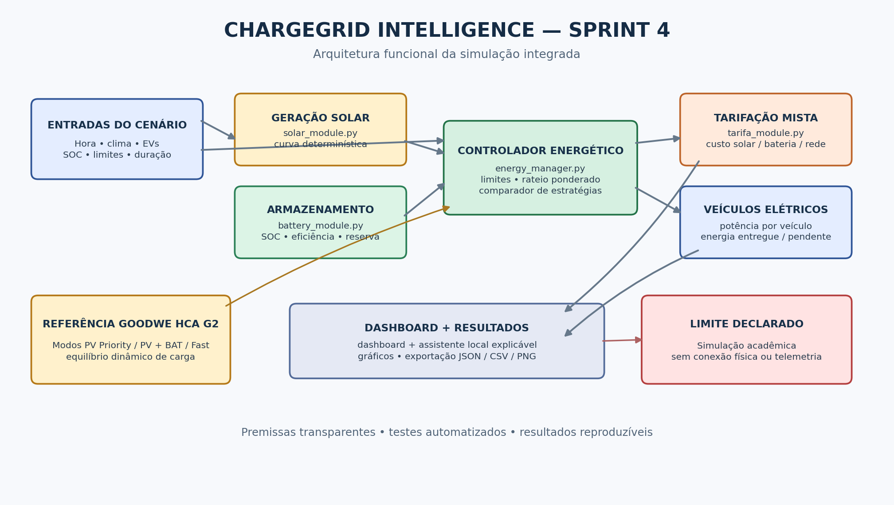
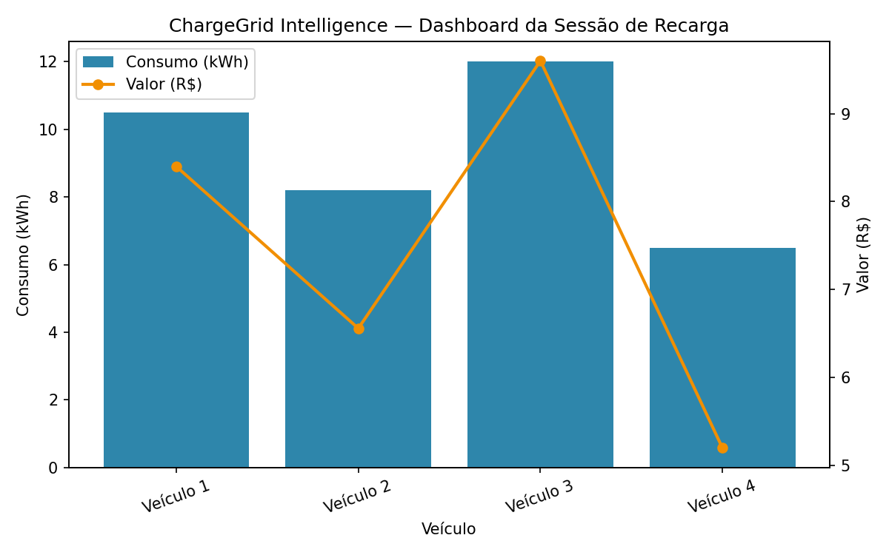

# ChargeGrid Intelligence — Sprint 4

**Solução Final Integrada e Inovadora | GoodWe Challenge | Lucas — 2º semestre**

> **Estado do protótipo:** simulador funcional e testado automaticamente. Os números deste repositório vêm de cenários simulados; a aplicação não possui ligação física com um inversor, bateria ou carregador GoodWe.

## Links do projeto

- **Repositório GitHub:** https://github.com/KaiqueKai/goodwe-chargegrid-poc2
- **Vídeo da Sprint 4 (YouTube, não listado):** `PREENCHER_DEPOIS_DE_PUBLICAR_O_NOVO_VIDEO`
- **Arquivo da entrega do Portal:** [`ENTREGA_SPRINT4.txt`](ENTREGA_SPRINT4.txt)

## Equipe

| Integrante | RM |
|---|---:|
| Kaique Da Silva Assis | 572718 |
| Andre Debiazzi Baldi Negrini | 569062 |
| Vinicius Cristal de Oliveira | 572049 |
| Lucas Barros | 571528 |
| Renan Eskildssen | 571097 |

## 1. Resumo executivo

O ChargeGrid Intelligence evolui a prova de conceito modular da Sprint 3 para um **simulador integrado de gerenciamento de energia para recarga de veículos elétricos**. O sistema avalia a geração fotovoltaica, a demanda de cada veículo, o limite de potência da estação, o limite de importação da rede e o estado de carga de uma bateria. Em seguida, distribui a potência disponível, estima o custo por fonte e compara três estratégias de carregamento.

A principal evolução não é apenas visual: a lógica de controle passa a aplicar limites elétricos e energéticos de forma explícita, separar potência de energia, modelar perdas de carga/descarga da bateria, dividir a energia atendida por veículo e produzir resultados exportáveis para auditoria.

### Diferenciais da Sprint 4

- **Despacho de energia por fonte:** solar direto, bateria e rede são contabilizados separadamente.
- **Balanceamento dinâmico de carga:** a potência compartilhada entre veículos não ultrapassa o limite da estação nem a potência máxima de cada veículo.
- **Gestão de bateria:** SOC inicial, reserva mínima, potência máxima, capacidade e eficiência são considerados; excedente solar pode ser armazenado.
- **Decisão explicável:** comparação dos modos `PV Priority`, `PV + Battery` e `Fast`, com critérios públicos (energia pendente, custo e emissões estimadas).
- **Painel visual:** métricas, gráficos por fonte, distribuição por veículo, comparação de estratégias e exportação JSON/CSV.
- **Assistente virtual local:** responde perguntas sobre solar, bateria, rede, custo, emissões e veículos usando os indicadores da sessão, sem credenciais nem envio dos dados a serviços externos.
- **Reprodutibilidade:** curva solar determinística e testes automáticos para que o mesmo cenário gere os mesmos resultados.

## 2. Problema que a solução aborda

Quando vários veículos carregam ao mesmo tempo, a soma das potências solicitadas pode ultrapassar a capacidade da instalação. Ao mesmo tempo, a disponibilidade de energia solar e o estado de carga da bateria mudam a quantidade de energia que precisa vir da rede. Uma estratégia fixa pode desperdiçar excedente solar, descarregar a bateria abaixo de uma reserva prudente ou não explicar por que a demanda não foi integralmente atendida.

O ChargeGrid Intelligence modela esse problema como um despacho limitado de potência e energia. O controlador protege os limites informados, calcula o que consegue atender e deixa visível o saldo de demanda que continua pendente.

## 3. Arquitetura integrada



A versão editável do diagrama está em [`docs/arquitetura_sprint4.mmd`](docs/arquitetura_sprint4.mmd).

### Evidência da evolução desde a Sprint 3

A imagem abaixo foi preservada do ZIP enviado da Sprint 3: ela apresentava consumo e valor por veículo, mas não mostrava a composição de energia por fonte, o balanço de bateria ou a comparação entre estratégias. A Sprint 4 mantém a estrutura modular anterior e acrescenta essas camadas.



O novo gráfico de referência está em [`reports/dashboard_sprint4_exemplo.png`](reports/dashboard_sprint4_exemplo.png), e o histórico das alterações técnicas está em [`CHANGELOG_SPRINT4.md`](CHANGELOG_SPRINT4.md).

### Fluxo de execução

1. **Entrada do cenário:** hora, duração do intervalo, condição climática simulada, limite da estação, limite da rede, SOC da bateria e pedidos de recarga dos veículos.
2. **Geração fotovoltaica (`solar_module.py`):** produz uma potência hipotética a partir de uma curva solar senoidal e um fator climático configurável.
3. **Controle (`energy_manager.py` + `ai_module.py`):** calcula a potência pedida, aplica limites por estação e por veículo, compara estratégias e escolhe uma recomendação reproduzível.
4. **Bateria (`battery_module.py`):** fornece energia respeitando SOC mínimo, potência máxima e perdas; pode receber excedente solar quando houver capacidade.
5. **Tarifação (`tarifa_module.py`):** calcula custo por parcela solar, bateria e rede, além de uma referência hipotética em que toda a energia entregue viesse da rede.
6. **Visualização (`dashboard_sprint4.py` + `dashboard.py`):** mostra o resultado agregado e individual, alertas e arquivos exportáveis.
7. **Persistência da demonstração:** o CLI salva o último resultado em JSON e uma imagem em `reports/`.

## 4. Tecnologias e responsabilidades

| Arquivo | Responsabilidade |
|---|---|
| `main.py` | Execução por terminal com valores padrão, validação básica e resumo completo. |
| `energy_manager.py` | Orquestração, balanço de potência/energia, limites, rateio e resultado estruturado. |
| `solar_module.py` | Perfil de geração fotovoltaica determinístico. |
| `battery_module.py` | Estado de carga, reserva mínima, limites de potência e eficiência. |
| `ai_module.py` | Escolha explicável do modo por energia pendente, custo e emissões estimadas. |
| `tarifa_module.py` | Tarifas demonstrativas e cálculo por fonte energética. |
| `dashboard_sprint4.py` | Dashboard interativo usando Streamlit, com seção de assistente virtual local. |
| `assistant_module.py` | Interpretação de resultados por regras, com respostas baseadas na simulação atual. |
| `dashboard.py` | Geração de gráfico estático para relatório e documentação. |
| `tests/` | Testes de limites, distribuição, bateria, balanço de fontes e validações. |
| `docs/` | Diagrama e documentação de método, hipóteses e integração GoodWe. |
| `reports/` | Cenário demonstrativo reproduzível e comparativo de modos. |

### Conceitos da disciplina aplicados

- Decomposição modular e separação de responsabilidades.
- Modelagem de sistema energético com entradas, estados, restrições e saídas.
- Algoritmo de decisão baseado em regras e critérios transparentes.
- Balanceamento de demanda e tratamento de limites operacionais.
- Testes automatizados, validação de entradas e análise de cenários.
- Visualização e interpretação de dados para apoiar decisões.

## 5. Relação técnica com GoodWe

A solução utiliza **conceitos funcionais documentados** para o carregamento de veículos elétricos, principalmente os modos de carregamento, o aproveitamento de energia fotovoltaica, a interação conceitual com bateria e o balanceamento dinâmico de carga. A linha GoodWe HCA G2 documenta os modos `Fast`, `PV Priority` e `PV + BAT`, além de recursos de gestão dinâmica de carga e comunicação, inclusive Modbus TCP em sua documentação técnica.

Referências oficiais consultadas:

- GoodWe Brasil — [Linha HCA G2](https://br.goodwe.com/carregadores-hca-g2-goodwe).
- GoodWe Brasil — [Área de downloads HCA G2 e documentos de compatibilidade](https://br.goodwe.com/download-hca-g2-series).
- GoodWe — [Manual do usuário HCA G2](https://br.goodwe.com/Ftp/EN/Downloads/User%20Manual/GW_HCA-G2_User%20Manual-EN.pdf).
- GoodWe — [Folha de dados HCA G2](https://en.goodwe.com/Ftp/EN/Downloads/Datasheet/GW_HCA-G2_Datasheet-EN.pdf).

**Limite importante:** o código não lê dados SEMS/GoodWe, não abre conexão Modbus e não envia comandos ao carregador ou inversor. Não foram fornecidas credenciais, dispositivo físico ou ambiente de homologação. Portanto, a integração apresentada é uma **prova de conceito de lógica de controle compatível conceitualmente com os recursos citados**, não uma integração física certificada. Para integração real seriam necessários modelo e firmware compatíveis, manual/protocolo específico, autorização, credenciais seguras e testes com o hardware em ambiente controlado.

## 6. Estratégias de carregamento implementadas

| Modo do simulador | Regra de despacho modelada | Objetivo demonstrativo |
|---|---|---|
| `PV Priority` | Solar direto primeiro; rede como complemento da recarga; não descarrega a bateria para o veículo. Excedente solar pode carregar a bateria. | Priorizar geração solar e preservar carga armazenada. |
| `PV + Battery` | Solar direto, depois bateria dentro dos limites, depois rede. | Aumentar uso local da energia e reduzir custo estimado em relação à rede. |
| `Fast` | Solar direto, depois rede até o limite configurado; bateria só complementa se a rede não for suficiente. | Favorecer disponibilidade de potência e preservar a bateria quando a rede dá conta. |

Os modos são simplificações acadêmicas inspiradas na terminologia do fabricante. Não reproduzem necessariamente todos os parâmetros internos, prioridades de firmware ou opções de configuração de um carregador real.

### Regra de recomendação

O modo automático simula cada estratégia a partir do mesmo estado inicial de bateria e escolhe primeiro o menor volume de energia não atendida, depois o menor custo estimado e, em caso de empate, as menores emissões estimadas. A lógica é intencionalmente transparente e auditável; **não é um modelo de machine learning treinado**.

## 7. Resultados quantitativos de referência

O arquivo [`reports/cenario_referencia.json`](reports/cenario_referencia.json) contém a saída estruturada produzida pelo próprio simulador. O cenário foi executado com:

- 3 veículos, cada um solicitando 7 kWh e limitado a 7 kW;
- janela simulada de 1 hora às 12h;
- potência fotovoltaica máxima configurada em 15 kW e fator climático de 0,85;
- limite da estação de 22 kW e importação da rede limitada a 15 kW;
- bateria de 20 kWh, SOC inicial de 50%, reserva mínima de 20% e potência máxima de descarga de 5 kW.

### Resultado da execução de referência

| Indicador | Resultado simulado |
|---|---:|
| Geração solar disponível | 12,75 kW |
| Demanda total | 21,00 kW |
| Potência atendida | 21,00 kW |
| Energia entregue durante o intervalo | 21,00 kWh |
| Energia solar direta usada pelos veículos | 12,75 kWh |
| Energia fornecida pela bateria | 5,00 kWh |
| Energia importada da rede | 3,25 kWh |
| SOC da bateria | 50,00% → 22,83% |
| Custo demonstrativo do cenário | R$ 10,45 |
| Referência didática usando apenas a rede | R$ 16,80 |
| Diferença estimada de custo | R$ 6,35 |
| Participação solar direta na energia entregue | 60,71% |
| Emissões estimadas pelo cenário | 4,763 kg CO₂e |
| Diferença estimada vs. referência toda-rede | 5,737 kg CO₂e |

No caso de referência, o modo escolhido automaticamente foi `PV + Battery`. O balanceamento distribuiu 7 kW para cada veículo, sem ultrapassar a potência máxima individual ou o limite total da estação.

A comparação dos modos está em [`reports/comparacao_modos.csv`](reports/comparacao_modos.csv), e o gráfico está em [`reports/dashboard_sprint4_exemplo.png`](reports/dashboard_sprint4_exemplo.png).

### Como interpretar os números

Os custos de R$ 0,40/kWh para solar, R$ 0,55/kWh para bateria e R$ 0,80/kWh para rede em período normal são **premissas didáticas configuráveis**, não tarifas oficiais. O cenário de referência de CO₂e usa fatores ilustrativos configurados no código: 0,05 kg CO₂e/kWh para solar e 0,50 kg CO₂e/kWh para rede/bateria. A energia que já estava armazenada na bateria é contabilizada conservadoramente com o fator da rede, pois o protótipo não rastreia a origem histórica dessa energia.

Consequentemente, economia e emissões são **estimativas de cenário**, não ganhos medidos em instalação real nem declaração ambiental certificada. Alterar tarifas, fator climático, potência instalada, SOC, duração ou limites altera os resultados; por isso os parâmetros e as premissas são exportados junto da lógica e descritos neste README.

## 8. Avaliação de sustentabilidade, benefícios e limitações

### Benefícios possíveis

- O uso direto da geração fotovoltaica reduz a energia que o cenário precisa importar da rede.
- A comparação de estratégias torna visível o compromisso entre custo demonstrativo, carga armazenada e energia não atendida.
- O limite de estação e o rateio por veículo evitam que a soma das cargas simuladas ultrapasse a potência operacional configurada.
- O acompanhamento do SOC e a reserva mínima tornam explícita a proteção do armazenamento.
- Exportação e visualização favorecem auditoria, apresentação técnica e tomada de decisão.

### Limitações reconhecidas

- Curva solar sintética, sem dados meteorológicos ou telemetria de uma instalação.
- Sem integração física com GoodWe, medidor, inversor, BMS ou carregador.
- Tarifas e fatores de emissão são didáticos e precisam ser substituídos por fontes locais válidas para qualquer estudo real.
- O despacho considera uma janela agregada; não modela fases elétricas, tensão, corrente instantânea, perdas de cabos ou normas de instalação.
- A energia da bateria já carregada não guarda rastreamento da origem (solar/rede).
- A regra de otimização é explicável, mas não substitui um EMS profissional, um estudo de engenharia elétrica nem as proteções homologadas do equipamento.

## 9. Instalação e execução no Windows

Use Python 3.10 ou superior. Na pasta raiz extraída:

```powershell
python -m pip install -r requirements.txt
python -m unittest discover -s tests -v
python main.py
```

Para abrir o dashboard interativo:

```powershell
streamlit run dashboard_sprint4.py
```

O Streamlit exibirá no terminal um endereço local (geralmente `http://localhost:8501`). Abra esse endereço no navegador se ele não abrir automaticamente. Na seção **Assistente virtual do ChargeGrid**, pergunte, por exemplo, “Como foi usada a energia solar?” ou “Compare os modos”.

### Demonstração rápida

Aceite os valores padrão pressionando Enter. Eles representam três veículos de 7 kW com pedido de 7 kWh cada, uma janela de 1 hora ao meio-dia, geração solar de referência com fator climático de 85%, limite de estação de 22 kW e rede limitada a 15 kW. O modo `AUTO` compara as estratégias e recomenda uma.

O programa salva `reports/ultima_simulacao.json` e `reports/dashboard_sprint4_exemplo.png`. O dashboard permite exportar resultados JSON e comparação CSV.

## 10. Testes automatizados

Execute `python -m unittest discover -s tests -v`. A suíte contém **25 testes automatizados aprovados na validação deste pacote**. Ela cobre curva solar, limites de estação e rede, reserva da bateria, carregamento por excedente, rateio ponderado por veículo, balanço entre fontes, conciliação de custos, estratégias de carregamento, validação de entradas e limites de capacidade.

Os testes confirmam o comportamento da **simulação**, não a segurança ou o comportamento de dispositivos físicos.

## 11. Entrega da Sprint 4

O enunciado informa que o Portal deve receber **apenas um arquivo `.txt`** contendo os integrantes/RMs, o link do novo vídeo não listado no YouTube e o link do repositório GitHub. Esse arquivo é [`ENTREGA_SPRINT4.txt`](ENTREGA_SPRINT4.txt). Substitua o marcador de vídeo somente depois de publicar o vídeo novo da Sprint 4; não reutilize o vídeo da Sprint 3 como se fosse o vídeo final.

O código, o diagrama, o README e os relatórios devem ser versionados no próprio repositório GitHub. O TXT é o arquivo a enviar ao Portal.
